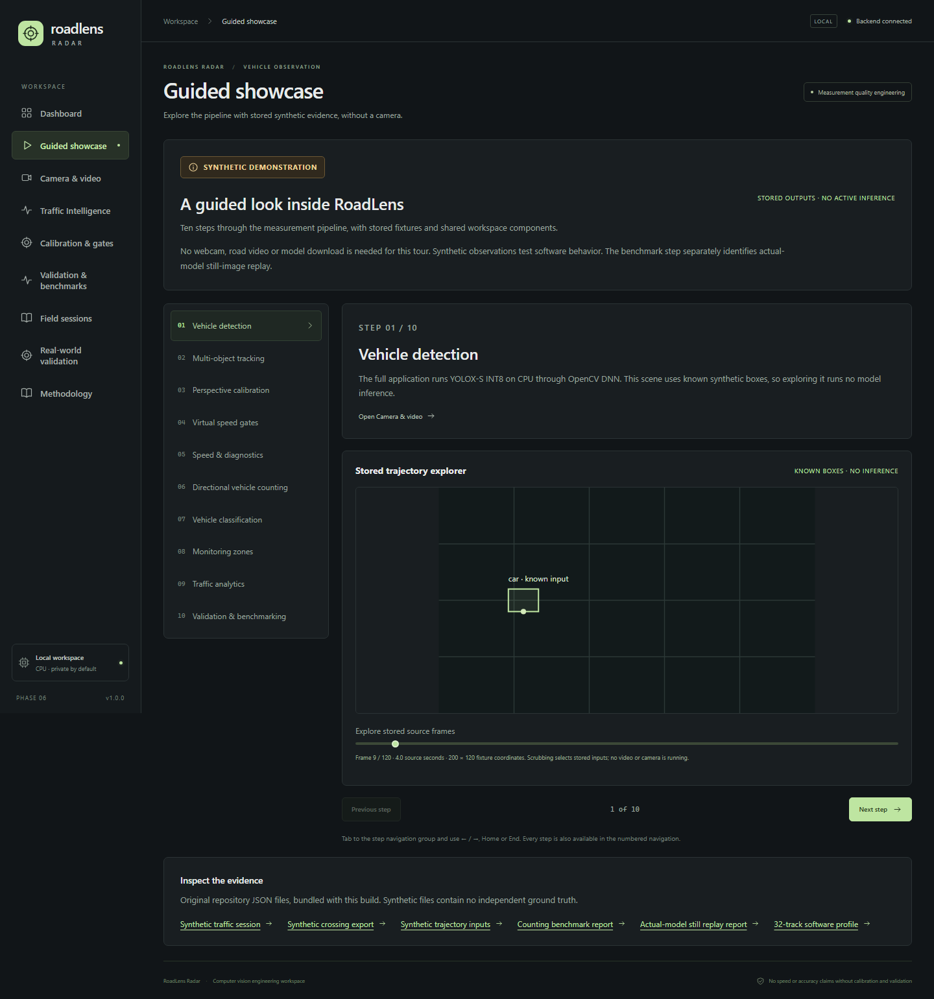
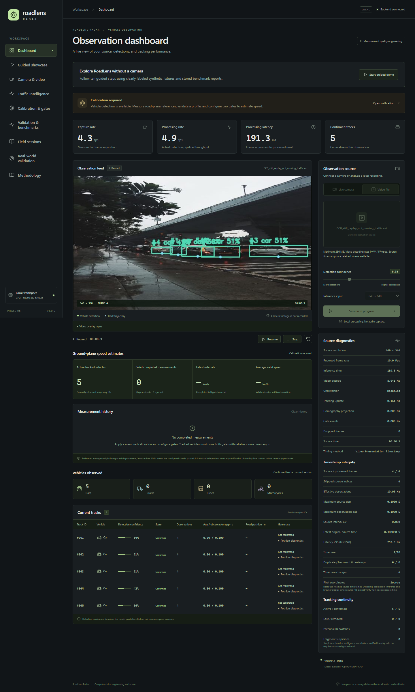
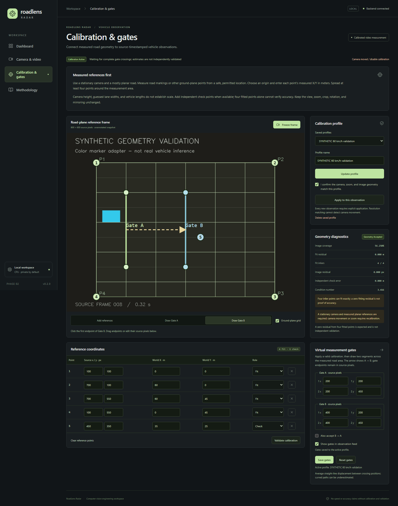
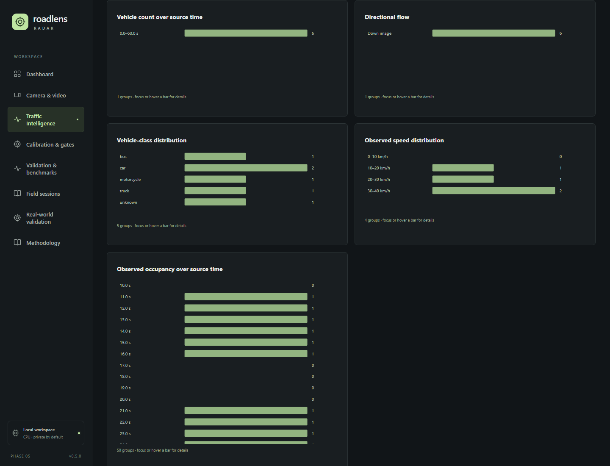
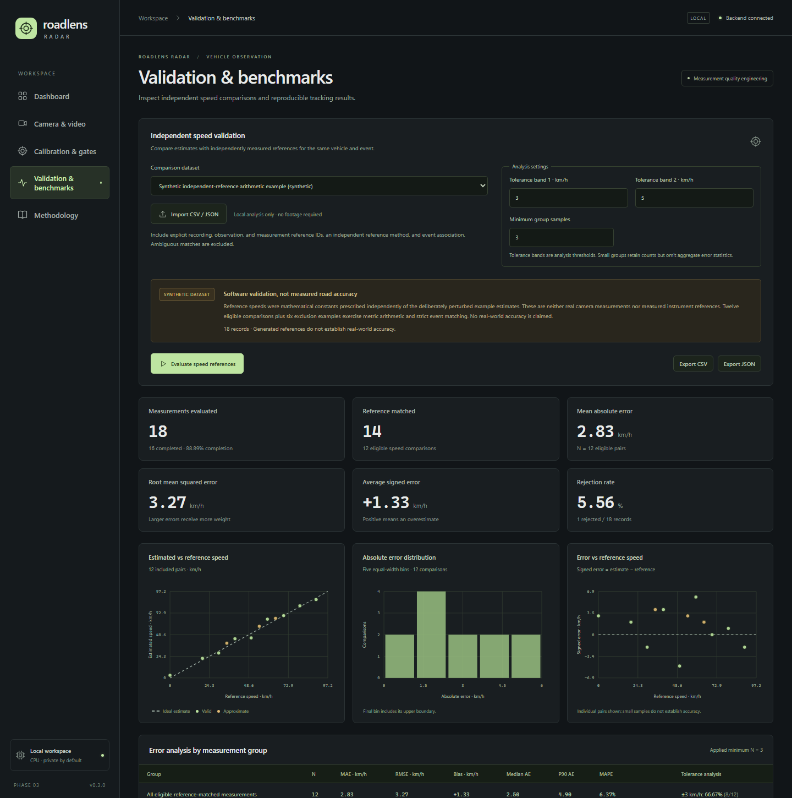

# RoadLens Radar

A local computer vision and traffic analytics workbench: CPU vehicle detection,
multiple-object tracking, calibrated speed estimates, directional counting and
inspectable validation evidence. Built as an engineering portfolio project for
Windows, with no Docker, GPU, API key or paid service required.

**v1.0.0 is ready for publication. Real-road speed and counting accuracy remain
unverified. This is not certified traffic enforcement equipment.**

| GitHub links | Publication status |
| --- | --- |
| Source repository | Pending creation; add the confirmed GitHub repository link here. |
| Live showcase | Pending deployment; add the URL returned by the successful Pages workflow here. |

[Publication commands and GitHub Pages setup](docs/github_publication.md) include
explicit URL templates. No public repository or showcase URL is claimed yet.



The guided showcase uses stored synthetic examples. It performs no inference.
The full local application runs the actual detector on explicitly selected inputs.

## Application views

| Detection and tracking dashboard | Road-plane calibration |
| --- | --- |
|  |  |
| Traffic analytics | Validation and benchmarks |
|  |  |

Screenshots are captured from the application. The detector image is an attributed
[CC0 photograph](backend/tests/fixtures/README.md) replayed as video; other pictured
measurements are synthetic. Older screenshots retain their original phase versions.

## Capabilities

- **Observe:** OpenCV Zoo YOLOX-S INT8 on CPU, four vehicle classes, global
  motion/IoU association, temporary IDs, trajectories and runtime diagnostics.
- **Measure:** optional lens calibration, measured planar homography, finite speed
  gates, interpolated source-time crossings and valid/approximate/rejected results.
- **Analyze:** directional crossing events, stable class evidence, image/ground
  zones, observed occupancy and dwell, covered-time flow and session comparisons.
- **Validate:** frame/PTS annotations, independent reference import, explicit event
  matching and clock alignment, held-out partitions, error metrics and CSV/JSON/HTML reports.
- **Explain:** ten-step camera-free showcase, shared native SVG charts, downloadable
  fixtures, bounded processing state and retained numerical provenance.

## Stack and architecture

Python 3.12–3.13 · FastAPI/Pydantic · OpenCV DNN · YOLOX-S INT8 · NumPy ·
PyAV/FFmpeg · React 19 · TypeScript · Vite · pytest · Vitest/Testing Library.
Storage is local JSON; preview delivery uses JPEG/MJPEG and typed HTTP snapshots.

```mermaid
flowchart LR
    Input[Camera or video] --> Frames[Acquisition and source time]
    Frames --> Lens[Optional lens correction]
    Lens --> Detect[YOLOX CPU]
    Detect --> Track[Global association]
    Track --> Measure[Road geometry and speed gates]
    Measure --> Traffic[Crossings and zones]
    Traffic --> Store[Local archives and analytics]
    Store --> API[FastAPI]
    API --> UI[React dashboard]
```



[Architecture and decisions](docs/architecture.md) ·
[Technical case study](docs/case_study.md) · [Model provenance](docs/model.md)

## Set up and run on Windows 11

Install Python **3.12–3.13** and Node.js **22.12+** with npm. Python 3.13.9 and
Node 24.16.0 are the versions exercised locally. Open PowerShell in the repository:

```powershell
powershell -NoProfile -ExecutionPolicy Bypass -File .\scripts\setup.ps1
powershell -NoProfile -ExecutionPolicy Bypass -File .\scripts\start-backend.ps1
```

In a second PowerShell window, from the same repository:

```powershell
powershell -NoProfile -ExecutionPolicy Bypass -File .\scripts\start-frontend.ps1
```

Open **http://127.0.0.1:5173**. The API is at **http://127.0.0.1:8000**.
Setup creates a virtual environment, installs pinned dependencies with `npm ci`,
and downloads/verifies the separately licensed 9.7 MB model. It preserves existing
environments. [Setup options and troubleshooting](docs/setup.md)

## Try the portfolio demo

Choose **Guided showcase** in navigation, then use **Next step**, **Previous step** or the numbered
steps. No webcam or recording is needed. Stored outputs are labeled
**SYNTHETIC DEMONSTRATION**; links open the corresponding full application views.
In **Traffic Intelligence**, load the synthetic example to inspect the editable
analytics/export workflow. [Demo walkthrough](docs/portfolio_demo.md)

An optional static build serves the same showcase without Python:

```powershell
Push-Location frontend
npm.cmd ci
npm.cmd run build:showcase -- --base=./
npm.cmd run preview:showcase
Pop-Location
```

Open the printed local URL. Output is `frontend/dist-showcase`. It contains stored
examples and charts, requests no camera/file permissions and runs no model.
[GitHub Pages workflow](.github/workflows/deploy-showcase.yml) builds only the
static showcase with base `/roadlens-radar/` and publishes `frontend/dist-showcase`.
After manual repository creation and Pages setup, pushes to `main` or a manual
workflow run trigger deployment. [Deployment instructions](docs/github_publication.md)
cover the required GitHub settings and link updates. No external deployment has
been performed during release preparation.

## Engineering evidence

Release checks: **647 backend tests** and **151 frontend tests** passed;
TypeScript and both production builds passed. Local Chromium verified the guided
tour at 390/768/1440 px and the static build under a nested path with the API stopped.
The complete verification record is in [testing](docs/testing.md). Historical
measurements below are separate experiments on an Intel Core i5-12450H / Windows 11:

| Workload | Recorded result | Scope |
| --- | --- | --- |
| Actual YOLOX, repeated CC0 still, 640 input, 12 measured frames | Detection **176.378 ms/frame**; traffic **0.212 ms/frame** | Five tracks/frame; excludes decode, overlays, HTTP and browser |
| Scripted 32-box detections, 200 frames | Tracker **3.235 ms**; added traffic **0.838 ms/frame** | No detector or video decode |
| Scripted crossing scenarios | **14/14** scenarios; **17/17** expected crossings; one expected suppression | Tests finite lines, jitter, gaps and fragmented identities |
| Scripted tracker comparison | ID switches **5 → 1**, mean update **0.0156 → 0.0390 ms** | Eleven tiny synthetic scenarios; extra stability costs CPU |
| Synthetic speed-reference arithmetic | **N=12**, MAE **2.833 km/h**, RMSE **3.266 km/h** | Deliberately prescribed errors, not observed road accuracy |

[Methods, hardware, exclusions and raw reports](docs/performance.md). These timings
must not be combined into an end-to-end FPS claim. No independently measured
moving-road speed/counting dataset or eligible redistributable traffic video is bundled.

## Checks

```powershell
powershell -NoProfile -ExecutionPolicy Bypass -File .\scripts\test.ps1
powershell -NoProfile -ExecutionPolicy Bypass -File .\scripts\build.ps1
.\.venv\Scripts\python.exe scripts\check_release.py
powershell -NoProfile -ExecutionPolicy Bypass -File .\scripts\smoke-install.ps1
```

The smoke script makes a separate source-only copy and fresh environment; it
preserves the development checkout. Local isolation is not an external clean-machine
certification. [Reproducibility record and checklist](docs/reproducibility.md)

## Limits and data handling

CPU inference is the dominant cost and does not guarantee real-time processing.
A homography assumes a stationary camera and planar road with measured references;
box bottom-centers approximate ground contact. Occlusion, ID changes, lens effects,
camera movement and uncertain source timing can invalidate measurements. Independent
references and untouched field recordings are still required to establish accuracy.

Camera frames are processed in memory; uploaded recordings and study archives stay
under ignored `data/`. No plate, face or owner identification is implemented. The
API is for loopback use. [Privacy](docs/privacy.md) · [Release audit](docs/release_audit.md)

## Repository

```text
backend/roadlens/   Detection, tracking, measurement, traffic and local APIs
backend/tests/     Regression tests and attributed still-image fixture
frontend/          React workspace and optional static showcase
scripts/           Windows setup, checks, fixture generators and benchmarks
examples/          Synthetic interchange data and demo manifest
docs/              Architecture, methods, evidence, screenshots and release guides
third_party/       Model license and attribution notices
```

[Calibration](docs/calibration.md) · [Traffic guide](docs/traffic_intelligence.md) ·
[Field workflow](docs/field_sessions.md) · [Validation](docs/validation.md) ·
[Release notes and known issues](docs/release_notes.md)

## License and attribution

First-party source retains its existing [MIT license](LICENSE). OpenCV Zoo's pinned
YOLOX artifact has separate **Apache-2.0** terms; downloaded weights are excluded
from Git. Retain [third-party notices](third_party/NOTICE.md) when distributing them.
The included traffic photograph is **CC0**, with its original author/source documented.
Synthetic fixtures carry no independent real-world ground truth.
[Demo asset sources and redistribution status](examples/demo/README.md)
