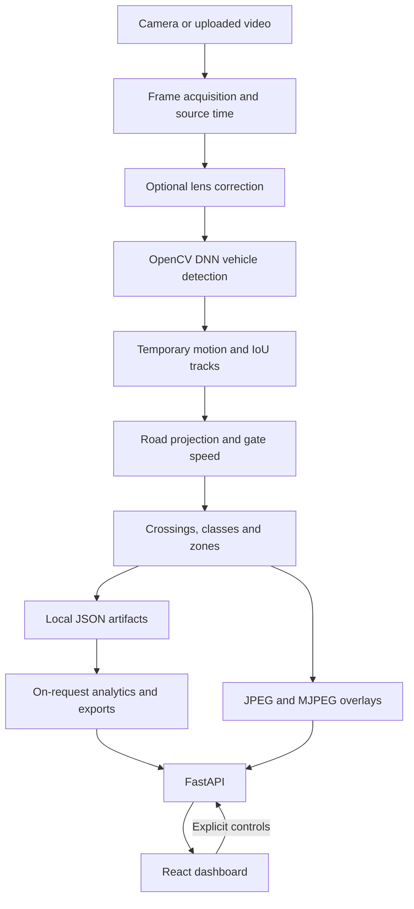
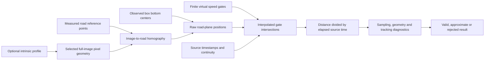
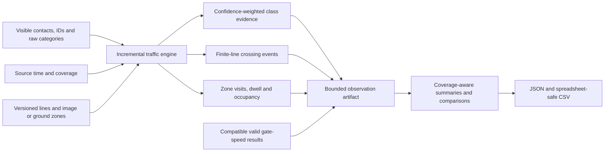
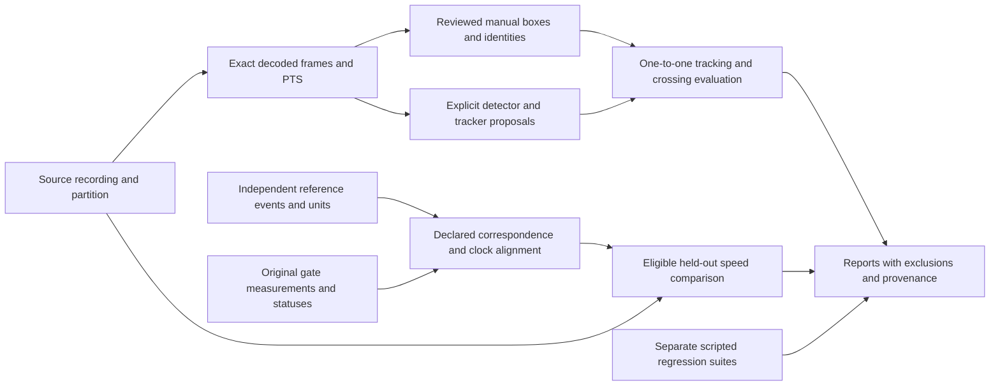

# Architecture

RoadLens Radar runs as one local FastAPI process and a React/Vite client. The backend owns capture, inference and measurement; the browser edits configuration and presents results. There is no database service, cloud inference, message broker or GPU requirement. The optional static showcase reads bundled demonstration artifacts and does not run this processing pipeline.

## Observation pipeline

[`SessionManager`](../backend/roadlens/session.py) owns the active source, worker, detector, tracker and measurement session. Live capture uses a capacity-one latest-frame buffer so slow inference cannot accumulate an old frame queue. Recorded video is decoded sequentially with PyAV. Live timestamps are monotonic acquisition times; recorded timestamps are decoded presentation timestamps (PTS). Decode, inference, HTTP and browser clocks are performance evidence, never replacements for measurement time. A nominal fallback video clock is diagnostic and cannot produce a numeric speed.

The main worker applies optional undistortion, detection, association, speed estimation and traffic updates before preparing overlays. Detector inference runs outside the session lock. A small traffic overlay state avoids serializing the complete event ledger for every frame. The browser polls snapshots and consumes MJPEG while running; paused/finished previews use a revisioned JPEG. Changing overlay visibility redraws the current frame without another inference pass.

### Model and CPU strategy

[`detector.py`](../backend/roadlens/detector.py) loads the pinned **OpenCV Zoo YOLOX-S INT8 block-quantized ONNX** artifact through OpenCV DNN, explicitly selecting its OpenCV backend and CPU target. It follows the published RGB, top-left letterbox, unnormalized float32 input and grid-decoding conventions, then filters COCO output to car, motorcycle, bus and truck. The existing implementation and tests verify 320, 416 and 640 square inputs with OpenCV 4.14.0; compatibility with another runtime is not assumed.

The selection provides an explicitly licensed, separately downloadable model and avoids a PyTorch/GPU runtime. The pinned [OpenCV Zoo directory](https://github.com/opencv/opencv_zoo/tree/48b10fa505aeb51fbd127fc60a5c660040e823b7/models/object_detection_yolox) states Apache-2.0 terms for its files. RoadLens retains the license and attribution in [`third_party/`](../third_party/NOTICE.md). The downloader verifies exact length and SHA-256 before atomic installation; Git ignores the downloaded weights. INT8 describes weight storage and does not establish a speed or accuracy advantage on arbitrary hardware. See [model provenance and inference contract](model.md).

### Tracking stability and cost

[`tracker.py`](../backend/roadlens/tracker.py) associates same-category detections using global maximum-cardinality/maximum-score assignment. Feasible scores combine IoU, contact distance, box shape and a short motion prediction. Velocity smoothing affects association only; returned boxes and measurement contacts remain raw observations. Three hits confirm a track, short misses retain a lost hypothesis, and a gap over one source second expires it. IDs are temporary; there is no appearance model or identity recognition.

The preserved [greedy baseline](../backend/roadlens/tracker_baseline.py) makes the tradeoff measurable. In the fixed 11-scenario synthetic comparison, ID switches fell from 5 to 1 while mean update time increased from 0.01560 to 0.03904 ms. Both trackers had three fragments and 18 deliberately omitted observations. These tiny one/two-object tests establish a regression result, not field tracking accuracy. The separate 32-box workload has a different cost. Methods, hardware and original reports are in [tracking benchmarks](benchmarks/tracking.md).

## Geometry, gates and measurement

[`calibration.py`](../backend/roadlens/calibration.py) fits the homography and caches inverse matrices, region hulls and grid geometry. [`speed.py`](../backend/roadlens/speed.py) consumes unsmoothed contacts, finite gates and source timestamps without rendering or HTTP dependencies. It interpolates crossings within observed segments and measures displacement between the two road-plane crossing positions. Quality flags describe the available evidence; they never multiply or otherwise correct a measured speed. Incomplete traversals remain explicit when an observation ends or continuity breaks.

All geometry is bound to a complete `ImageGeometry`: resolution, rotation, mirror, crop, coordinate space and intrinsic-profile identity. Optional `FrameUndistorter` correction happens before detection, uses cached OpenCV remap tables, preserves dimensions with `K_new = K`, and does not crop. Boxes, contacts, references, gates and annotations therefore use one selected pixel space. The current capture pipeline activates only unrotated, unmirrored, uncropped intrinsic profiles. A model change requires a paused/ended observation, invalidates road geometry and clears temporary associations. Revision checks prevent in-flight work from publishing an old coordinate space.

Camera profiles are immutable UUID-addressed parameter records. Checkerboard fitting retains reprojection diagnostics and discards input photographs. Unannotated calibration JPEGs stay in memory with at most three retained; browser SVG editing maps CSS positions back to source pixels. The operator must still confirm that the physical camera, lens, focus and view have not moved.

Pausing interrupts unfinished traversals. An already-decoded video packet waits for resume; pre-resume live packets are discarded. Stop/EOF finalizes incomplete rejections while retaining completed results. Reset starts a new observation. Save a field session before changing configuration when original measurement evidence must remain available.

## Traffic intelligence

[`TrafficEngine`](../backend/roadlens/traffic_engine.py) consumes the actual tracker output; it does not run another detector or replace the speed estimator. Counting lines are independent of speed gates. A crossing requires stable opposite sides outside a hysteresis band and intersection of the finite line. Events retain interpolated source time, direction and configuration version. A temporary ID counts once per line/direction/version. Tentative observations do not count.

A narrow duplicate heuristic can suppress an unambiguous nearby repeated crossing after the old ID disappears. Simultaneously observed vehicles and ambiguous candidates are retained. Suppressions remain exportable with reasons; this is not proof that two tracks are the same physical vehicle. Summing several lines counts crossings at each line.

Supported classes accumulate confidence-weighted evidence with minimum-observation, score and margin requirements; insufficient evidence becomes `unknown`. Scores are not calibrated probabilities. Raw detector category/confidence remain attached to events. The tracker still associates within a raw category, so a category change can fragment a track.

Image zones need no metric calibration. Ground zones bind to a compatible road calibration and require valid world positions. Independent overlapping zones use boundary hysteresis; dwell includes only consecutive observed inside time. Loss, pause and end can leave incomplete visits. Image-box occupancy and pixel stationarity are labeled heuristics. Slow-track indicators require valid metric speed; image displacement is never converted to km/h. Invalid source time permits untimed current image visibility, but contributes no crossing, dwell, class-history update, timed sample or coverage.

Configuration edits create immutable versions and break interpolation. Geometry changes preserve historical records and create an empty configuration; regions are never automatically scaled into another image space. Current configurations are indexed by source identity and full geometry. Ground zones additionally bind to the road calibration.

Histories are bounded independently of lifetime totals: 10,000 crossings and zone events each, 5,000 occupancy samples, 10,000 coverage segments, 128 configurations, 4,096 identity/tombstone entries each, and 2,048 region summary keys. Overflow is disclosed. A small current overlay state is separate from deep artifact snapshots. Once old ID tombstones are omitted, their protection is limited; normal IDs advance monotonically.

[`traffic_analytics.py`](../backend/roadlens/traffic_analytics.py) runs on explicit requests. It unions source-time coverage and groups 1/5/15/30/60-minute windows by configuration. Counting-rate exposure includes only intervals with active lines; selecting a line restricts its exposure further. Missing/truncated history withholds unsupported normalized rates. Lifetime summaries and retained filtered tables remain distinguishable. A short or interrupted observation does not become a measured hourly volume.

Speed aggregates include only the selected valid or approximate cohort. Rejected values are excluded. A crossing receives speed only from a unique same-source/session/track gate interval that contains its timestamp. Seven export tables retain units, filters, quality and provenance. Empty CSV exports carry a marked metadata row rather than a fabricated event. See [traffic intelligence](traffic_intelligence.md).

## Validation and evidence boundaries

[`offline_video.py`](../backend/roadlens/offline_video.py) indexes actual decoded ordinals and PTS. Timestamp navigation returns the nearest actual frame and its real timestamp. Annotation navigation retains at most three navigators, each with at most eight recent images within a 64 MiB budget. An uncached backward seek decodes from the start to preserve frame identity. Archived intrinsic parameters preserve the annotation pixel space even after profile changes.

Manual identity strings and predicted integer track IDs remain separate. Reviewed empty frames, visibility flags and optimistic document revisions are preserved. When source pixels are available, saves verify geometry and timestamps. Proposals are explicit, bounded to 100 consecutive frames and require a paused live observation. Each run replaces only its prediction scope. Category/IoU box matching reports matches, misses, false positives, switches and fragments; it does not implement IDF1, MOTA or HOTA.

Counting evaluation derives truth crossings only from consecutive reviewed visible trajectories, finite lines and overlapping source/configuration coverage. Global one-to-one time/line/position matching ignores predicted class and direction so those errors remain measurable. Unreviewed and unknown intervals are excluded. Manual boxes do not supply independent metric-speed evidence.

[`field_alignment.py`](../backend/roadlens/field_alignment.py) retains reference units, provenance, quality and explicit event correspondence. The mapping is `source time = offset + scale × reference time`; fitting drift requires several independent anchors. Ambiguous, unconfirmed, unmatched and time-incompatible pairs remain retained and excluded from confirmed speed arithmetic. Whole recordings, collection groups and declared near-duplicates stay in one development/calibration/held-out partition. Undeclared duplicate recordings cannot be inferred from metadata.

Reports preserve original statuses, settings, exclusions, timing and calibration. Synthetic, recorded-unverified and independent-reference evidence are separated. Instrument independence is an operator declaration, not certification. No physical roadway, camera or independent real-world speed instrument was tested during implementation. The [performance report](performance.md) separates software experiments by workload.

## Persistence and local boundaries

| Path | Stored content |
| --- | --- |
| `data/uploads/` | Uploaded video and SHA-256 catalog; safe relative paths |
| `data/calibrations/` | Road references, held-out checks and gates |
| `data/camera_profiles/` | Intrinsic parameters and target diagnostics |
| `data/field_sessions/` | Observation metadata, original measurements, references, alignment and partition |
| `data/annotations/` | Revisioned manual labels and separate predictions |
| `data/traffic/sessions/` | Traffic artifacts, coverage and configuration versions |
| `data/traffic/configurations/` | Current source/geometry-bound regions |

Stores write typed/validated local JSON atomically. Traffic artifacts have a 32 MiB file cap and expose save errors. Identical uploaded content reuses a cataloged recording. Ended traffic observations archive automatically; manual archival is also available. Session/report exports contain metadata/results rather than copied footage or absolute source paths. Webcam footage is not automatically recorded.

The API is a loopback development service with host/origin checks, bounded uploads and decoder validation. It is not an authenticated public deployment. `data/`, environment files, caches and model weights are excluded from source distribution. The static showcase has a smaller boundary: bundled artifacts, shared React/SVG views and no capture/inference calls. See [privacy](privacy.md), [field procedure](real_world_validation.md), [annotations](annotations.md) and the [Phase 5 source map](phase5_changes.md).
