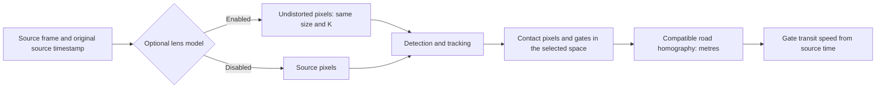

# Optional camera intrinsics

Lens calibration, roadway calibration and independent speed validation answer different questions. A pinhole lens profile describes how image rays are distorted. The road homography maps visible road-plane pixels into metres. Independent reference observations test the completed speed measurement. A small checkerboard reprojection residual establishes neither a correct road model nor road-speed accuracy.

This workflow uses OpenCV's checkerboard corner detection, `calibrateCamera`, `initUndistortRectifyMap` and `remap`. The [OpenCV camera calibration tutorial](https://docs.opencv.org/4.x/dc/dbb/tutorial_py_calibration.html) explains the target geometry and reprojection diagnostics. RoadLens supports the standard five-coefficient pinhole model and imports standard eight-coefficient rational models. Fisheye models are outside this implementation.

## Collect target images

1. Use a flat, rigid checkerboard with sharply printed squares. Measure one square side in millimetres; count inner corner intersections. Ten by seven squares means nine by six inner corners.
2. Fix the intended camera resolution, lens, zoom and focus. Disable automatic zoom and lock focus where the device permits it. Photograph the board using the same image geometry as the roadway recording. A camera can remain fixed while the board moves indoors.
3. Capture 10–20 sharp images at different board angles, distances and positions. Include edges and corners of the image. Keep the complete board visible and avoid reflections, motion blur and a bent target. Six diverse accepted views are the software minimum, not a claim of sufficient calibration quality.
4. In **Real-world validation → Camera**, enter a profile name, stable camera configuration identifier, inner columns/rows and square size. Record camera/lens, focus and zoom settings. Select the images and choose **Fit and save camera profile**.
5. Inspect the fitting diagnostics and rejected-image reasons. Duplicate images, nearly identical poses, very small targets, inconsistent resolutions and unreadable images are rejected. Weak coverage and large residuals produce warnings. A model with implausible focal length, a singular matrix or a folding distortion function is rejected.

The fitter accepts 6–40 images, each at most 8 MiB, with a total upload limit of 64 MiB. Images must be between 64 and 4096 pixels per side and at most 12 megapixels. Source images are read for fitting and discarded; the store retains parameters, per-image errors, filenames and hashes. Use generic target filenames if filenames contain personal information. Exported profiles contain no image pixels.

## Apply and inspect

1. Start a matching video or camera observation and pause after a frame appears. Select the saved lens profile and compare **original and corrected** frames. Black pixels at corrected borders are expected; RoadLens does not crop them away.
2. Check the exact camera, lens, resolution, zoom, focus, rotation, mirroring and crop. Confirm they match, then apply correction. Runtime activation currently supports unrotated, unmirrored, uncropped sources. Profiles can document other geometry, but the capture pipeline cannot activate it.
3. Applying or disabling the model invalidates the active roadway calibration and clears old transient tracking state. Freeze a new frame in **Calibration & gates**, place all image references on this corrected frame, enter measured road distances, add independent check points, and redraw gates. Never copy source-coordinate gates into a corrected image.
4. A new observation requires explicit model selection again. Resolution changes block correction. Metadata changes such as lens zoom cannot be inferred reliably from ordinary webcam frames: the operator must disable the model, record the change, refit if needed, and recalibrate the roadway.

The corrected frame has the same dimensions and camera matrix as the source (`K_new = K`), with no resize or crop. Maps are cached once per profile activation. The entire image is corrected **before detection** so boxes, bottom-center contact points, tracking trajectories, gates, road references, homography projection and overlays share one image coordinate space. The browser scales that image for display; its CSS coordinates are never road-reference coordinates. Calibration geometry stores `coordinate_space` and `intrinsic_profile_id`, preventing a source-pixel homography from being applied to corrected pixels or a different intrinsic profile.



## Persistence, imports and evidence

Intrinsic profiles are immutable UUID-addressed local JSON files. Reimporting identical JSON is idempotent; changing an existing ID's parameters is rejected. Fit a new profile to make changes. Export/import preserves the coordinate policy, calibration metadata and diagnostic fields. Imported diagnostic values are supplied evidence and are not independently recomputed without the original target images. Never present an imported residual as verified field accuracy.

Compare lens correction using the same footage, independent references, synchronization decisions and held-out partition. Retain baseline measurements in source pixels and corrected measurements separately with their own road calibrations. Do not infer improvement from a straighter-looking image or tune a multiplier against held-out errors. Distortion correction cannot fix road slope, a non-planar surface, tracking identity mistakes, uncertain contact points or reference-clock errors.

## Reproduce the synthetic check and cost measurement

```powershell
.\.venv\Scripts\python.exe -m pytest backend/tests/test_camera_intrinsics.py -q
.\.venv\Scripts\python.exe scripts/benchmark_camera.py --output docs/benchmarks/camera_phase4.json
```

The tests project known three-dimensional target points through a synthetic camera and also render checkerboard images to exercise OpenCV's real corner finder. Point correction, same-size frame remapping, road-coordinate compatibility and model rejection are checked. The benchmark times map creation separately from cached correction at 640 × 480 and 1280 × 720. Generated pixels contain no real roadway evidence. Hardware, OpenCV threading and repetitions are recorded in the JSON report; timings are local observations and can vary with CPU load.

The committed [synthetic benchmark](benchmarks/camera_phase4.json) records a 0.0000101 px fitting RMS on ten exact projected target views and cached correction means of 0.911 ms at 640 × 480 and 2.069 ms at 1280 × 720 over 200 repetitions. The host reported Intel64 Family 6 Model 154, twelve logical CPUs, Windows 11 and OpenCV 4.14 with twelve threads. These are software-fixture and component-cost results; neither end-to-end detection performance nor physical-camera accuracy was measured.
